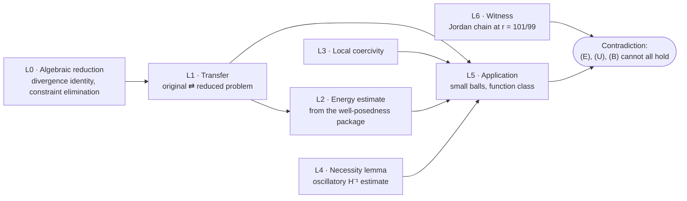

# rarita-schwinger-well-posedness

**Exact algebraic witness and full verification suite for a well-posedness obstruction in charged, Pauli-coupled Rarita–Schwinger fields on ℝ×S²×S².**


[](https://doi.org/10.5281/zenodo.24413648)


*`COMPLETE_PASS` is the validator's verdict on its 36 specified checks. It is not a certification of the theorem.*

---

## The result in one paragraph

For a charged, massive spin-3/2 (Rarita–Schwinger) field with Pauli coupling, on the background ℝ × S²(1) × S²(3) with a parallel magnetic field, the local Cauchy problem **cannot simultaneously have existence, uniqueness, and an L² energy bound that loses no derivatives** at the explicit parameter point λ² = 1/2, m² = 823/142944, π′ = 1/2 (Pauli slice). This holds on every sufficiently small shrinking geodesic cone, for every cone speed c > 0, and at every Sobolev level ℓ ≥ 2. The obstruction is an exact, checkable algebraic object: after the constraints are eliminated, the principal symbol has a **Jordan block** (eigenvalue r = 101/99, two J₂ blocks) on the constraint-admissible directions. A necessity lemma turns this block into a contradiction with any loss-free bound.

**New to the topic?** Start with [In plain terms](#in-plain-terms), then [BACKGROUND.md](BACKGROUND.md). **Specialist?** Jump to [the argument in more detail](#for-specialists-the-argument-in-more-detail) or [check the witness in one command](#check-it-yourself).

📄 **Paper:** [version 2 (PDF)](paper/main.pdf), with its [LaTeX source](paper/), also on [rxiVerse:2611.0051](https://rxiverse.org/abs/2611.0051) · AI-reviewed only, not peer reviewed · 🔖 **DOI:** [10.5281/zenodo.24413648](https://doi.org/10.5281/zenodo.24413648)

🧭 **Follow-up work** on whether the witness is isolated ([ROADMAP §2](ROADMAP.md#2-is-the-witness-isolated-or-part-of-a-family)) is in a separate, exploratory repository: [rarita-schwinger-off-slice](https://github.com/samderenzis/rarita-schwinger-off-slice). Nothing there is part of this result.

## In plain terms

A physical field equation is only useful for prediction if, given the state of the field now, it determines the future: a solution must **exist**, it must be **unique**, and small changes now must cause only controlled changes later (an **energy bound**). Mathematicians call this *well-posedness*.

This work examines one of physics' notoriously awkward fields, the field of a massive, electrically charged particle of spin 3/2, in a carefully chosen curved space with a magnetic field. It shows that, at one explicit choice of the parameters, the equations **cannot have all three properties at once** in their strongest form. The reason is a hidden degeneracy, a *Jordan block*, in the way waves move through the equations. Picture two wave modes locked together, so that one keeps feeding the other. The resulting growth cannot be controlled by any energy bound that loses no derivatives.

The degeneracy is written down exactly: it involves only fractions and the imaginary unit, with no rounding. Anyone can check it in seconds (see [Check it yourself](#check-it-yourself)).

## Why this question

Charged spin-3/2 fields have been a known trouble spot since **Velo and Zwanziger (1969)**. They showed that the simplest coupling of such a field to an electromagnetic field lets signals travel faster than light. Modified equations have been proposed ever since, for example by **Khalil (1977)**. The phenomenon has been re-examined many times since, for instance by **Frauendiener (2003)**. A natural modification adds a *Pauli coupling* (a direct interaction with the field strength). This work asks a sharper, purely mathematical question about such a Pauli-coupled theory: is its initial-value problem well-posed in the standard L² sense, on a fixed curved background?

The tools come from the theory of hyperbolic equations. Necessary conditions of this kind, where degenerate characteristics rule out well-posedness, go back to **Ivriĭ and Petkov (1974)**, with a modern L² treatment by **Métivier (2014)**. The constrained setting connects to **Abalos and Reula (2020)**.

## Main theorem (informal statement)

> There is r\* ∈ (0, π/6] such that for every R ∈ (0, r\*/2), every integer ℓ ≥ 2, every c > 0 and every T ∈ (0, R/c), no constants K ≥ 1, α ≥ 0 make the following hold together, **for every start time s ∈ [0, T) with the same K and α**, on the shrinking geodesic cones B_t = B_d(y₀, R − ct):
> **(E)** existence of H^ℓ solutions from every constrained H^ℓ datum,
> **(U)** uniqueness in the much larger class C¹(L²) ∩ C(H¹),
> **(B)** the loss-free bound ‖Φ(t)‖_{L²(B_t)} ≤ K e^{α(t−s)} ‖Φ₀‖_{L²(B_s)} for all t ∈ [s, T].
>
> The cones are shrinking geodesic balls B_d(y₀, R − ct), with an arbitrary speed c > 0; they are not identified with physical light cones.

The precise statement, definitions and the full written proof are in the [paper](paper/main.pdf) (version 2). This repository also holds the exact witness and every computation the proof relies on.

## The witness

At the covector ξ\* = (20/99, 0, 1, 0) and r = 101/99, there are exact vectors v ≠ 0 and w (entries in ℚ(i)) with

$$L v = 0,\qquad L w = 0,\qquad (P - r)\,v = 0,\qquad (P - r)\,w = v,$$

where P is the principal symbol of the reduced evolution operator and L that of the constraint. With $a_\gamma = v - i\gamma w$,

$$\big(\gamma - i(P - r)\big)\,a_\gamma = -\,i\gamma^2 w,$$

so any loss-free bound would give $|v| \le (1+K)\,\gamma\,|w|$ for all γ > 0, which forces v = 0, a contradiction.

The exact v, w, P, L and det S⁰ = 3063716808343140625 / 132101812606622109696 are in [`data/`](data/), readable without running anything.

## For specialists: the argument in more detail

<details>
<summary><b>Setup, reduction, necessity lemma and witness</b> (click to expand)</summary>

**Background and equations.**
- The background is the product 𝕄 = ℝ_t × S²(1) × S²(3) (b₁ = 1, b₂ = 1/3) with the parallel 2-form F = b₁e¹∧e² + b₂e³∧e⁴. It is used on one chart V′ around y₀ = (π/2, 0, π/2, 0), with the local potential A = −cot θ₁ e² − cot θ₂ e⁴.
- The field is a vector-spinor ψ = (ψ₀, Φ), with Φ ∈ ℂ¹⁶. The equations are R^ρ[ψ] := Γ^{ρνσ}(𝒟_νψ)_σ = 0, where 𝒟 contains the spin connection, the charge q and a mass/Pauli term X built from m, λ and F.
- The witness lies on the Pauli slice q = λ√(2/3)·m, at λ² = 1/2, m² = 823/142944 and π′ = 1/2.

**Exact reduction (no lower-order terms dropped).**
- A divergence identity (D+Ŷ)_A R^A[ψ] = S^ρψ_ρ holds for every ψ. It rests on the Clifford intertwining Ŷ_μΓ^{μνρ} = Γ^{μνρ}X_μ; on this background the S^ρ are constant frame matrices.
- Since det S⁰ = 3063716808343140625 / 132101812606622109696 ≠ 0, ψ₀ = 𝒲Φ is eliminated algebraically. This leaves an evolution ∂_tΦ = K′Φ with a single first-order constraint R⁰Φ = 0. There are no further constraints.
- The exact differential identities R⁰(∂_t − K′) = ★R⁰ and R⁰K′ = 𝒞R⁰ show that K′ maps sufficiently regular exactly constrained fields to constrained fields. This algebraic mapping property is what the proof uses. Automatic propagation of zero constraint for arbitrary reduced solutions is not separately established here.
- So any loss-free L² package for the original system (existence in H^ℓ, uniqueness in C¹(L²) ∩ C(H¹), the bound with constants K, α) gives the same package for the constrained evolution, with the same K and α. That in turn gives an a priori estimate on exactly constrained test functions.

**Small-ball coercivity.**
- The constraint symbol satisfies L(ξ)L(ξ)† = 3|ξ|²I₄ for all ξ; this is exact, for symbolic ξ.
- Freezing coefficients, with a Poincaré inequality, gives ‖R⁰*ρ‖_{L²} ≥ c₀‖ρ‖_{H¹} on small geodesic balls, with σ = √3·min(b₁, b₂).

**Necessity lemma (variable coefficients, constrained).** Assume small-ball coercivity and the a priori estimate. Then

  γ|a| ≤ K₀ |(γ − i(P(y₁,k) − τ)) a|   for every a ∈ ker L(y₁,k), all points y₁ of the ball, all k ≠ 0, all τ ∈ ℝ and all γ > 0.

- This is a restricted resolvent bound on the kernel of the constraint symbol.
- It does **not** assume P·ker L ⊂ ker L.
- The proof uses concentrated wave packets, corrected back onto ker R⁰ by an exact Dirichlet/Lax–Milgram projection. It is a constrained analogue of the necessity direction in Ivriĭ–Petkov and Métivier.
- The crux is a two-derivative oscillatory bound (Lemma 4.5 in the paper): ‖e^{iΛk·y}g‖_{H⁻¹} ≤ C(2(Λ|k|)⁻¹‖g‖ + 4(Λ|k|)⁻²‖D²g‖). The one-derivative version is not enough. Numerical attacks, including an adversarial optimiser, never exceed 0.50 of the bound.

**The witness.**
- At the one selected covector ξ\* = (20/99, 0, 1, 0), P(ξ\*) has only real eigenvalues: ±101/99, each of multiplicity 6, and ±101/198, each of multiplicity 2. This is a statement about this direction only, not about all directions or causality.
- At r = 101/99, dim ker(P − r)^j = 4, 6, 6 for j = 1, 2, 3. That is two J₂ and two J₁ blocks.
- A Jordan chain v → w lies inside ker L(ξ\*), with rank L = 4.
- Testing the resolvent bound on a_γ = v − iγw and letting γ → 0 forces v = 0. This is the contradiction.
- The same invariants appear in the other, inequivalent 5D Clifford representation (Γ⁴ → −Γ⁴).
- **Independence of π′ (this family only).** The part of P on ker L does not depend on the constraint-addition parameter: P_{π′} − P_{π″} = (π′ − π″)M⁻¹TL, which vanishes on ker L, so the chain holds for every π′. The eigenvalues ±101/198 are ±π′|ξ\*| at π′ = 1/2. This is proved in the paper; it is independence within this one family of constraint additions, not formulation independence in general.

**What is deliberately not claimed.** The theorem rules out the conjunction (E) ∧ (U) ∧ (B) for this local formulation. It does not identify which property fails. It does not address C^∞ or Gevrey well-posedness, where lower-order (Levi-type) conditions could matter. It makes no global, formulation-independent, causal or physical claim.

</details>

## The proof at a glance



How each link was checked, with blind derivations, audits, exact computation and re-execution, is in [HOW_IT_WAS_CHECKED.md](HOW_IT_WAS_CHECKED.md).

## Check it yourself

Three levels, from no software at all to full re-computation:

1. **Read the certificate.** Open [`data/witness.txt`](data/witness.txt) and verify the four witness relations above by hand or with any computer algebra system. Or run the standard-library-only checker (no installs needed):
   ```bash
   python data/read_witness.py      # uses only Python's built-in fractions module
   ```
   The one-command checker verifies the finite algebraic witness. It does not by itself verify the reduction from the field equations (step 2) or the analytic necessity lemma (written proof, in the paper), both of which the full theorem needs.

   It finishes in about a second and prints:
   ```
   L v = 0        True
   L w = 0        True
   (P - r) v = 0  True
   (P - r) w = v  True
   v != 0         True
   ALL WITNESS RELATIONS HOLD
   ```
2. **Run the proof scripts** (a few minutes):
   ```bash
   pip install sympy
   cd scripts
   python witness_min.py              # det S⁰, LL† = 3|ξ|²I, the Jordan chain, the a_γ identity
   python check_1_clifford_intertwining.py   # and check_2 … check_5
   ```
   Each script prints `True` for every identity it verifies. The expected output is listed in [`results/golden_outputs.txt`](results/).
3. **Run the full validation suite** (about 3 minutes at standard level on a 12-core desktop):
   ```bash
   pip install sympy numpy scipy mpmath python-flint requests
   python bhmap_validate_v1_7.py --level standard --online
   ```
   Run it from the repository folder: it detects the repository automatically. Use `--level deep` for the full stress test (considerably longer); `--online` adds the citation checks (Crossref, arXiv). A complete run ends with `VERDICT: COMPLETE_PASS`. **[RUNNING_THE_VALIDATOR.md](RUNNING_THE_VALIDATOR.md)** explains every option, the verdicts, the output files and how to compare your run with ours.

   In this repository the archive checks verify the repository itself (every file against `SHA256SUMS`, the pinned scripts, and `data/witness.json` against a fresh recomputation). Three checks that need the project's private working archive (A2, A3, A5) are reported as **NA** (not applicable), listed, and never counted as passes. All published runs are in [`results/`](results/).

## What the validation covers

| Group | What is checked | How |
|---|---|---|
| **A** Archive | file integrity, archived scripts reproduce their output | sha256 manifests, golden-output comparison |
| **B** Algebra | Clifford relations, intertwining identity, LL† = 3\|ξ\|²I, representation independence (incl. non-unitary and dense basis changes) | exact arithmetic |
| **C** Geometry & operators | connection and Einstein tensor re-derived from the metric; divergence and constraint identities | symbolic + 60-digit evaluation |
| **D** Witness | Jordan structure (alg. multiplicity 6, two J₂ blocks), determinants, chain identities | three different engines (SymPy, FLINT, pure-Python fractions), all in this project's code |
| **E** Analysis | the key oscillatory H⁻¹ inequality (paper's Lemma 4.5; "Lemma 4.1" in the validator), coercivity constants, ball geometry | numerical falsification incl. an adversarial optimiser (worst ratio ≈ 0.50, limit 1) |
| **F** Logic | finite-dimensional models of the abstract argument | illustration only |
| **G** Literature | every cited DOI and arXiv identifier resolves; core references match on year, volume and first page. This checks identifiers and metadata only, not what the sources say or whether they support the claims they are cited for | Crossref and arXiv APIs |
| **H** Self-tests | deliberately corrupted inputs must be caught | mutation tests of the checks themselves |

### Published runs

All runs were made by the project owner on a Ryzen 9 9900X. Every results file is in [`results/`](results/).

| Run | What was checked | Verdict | Highlights |
|---|---|---|---|
| **v1.7, full archive** (standard, online) | the complete private working archive | `COMPLETE_PASS`: 34 PASS, 1 INFO, 1 NA (A7, repository-only); 36/36 accounted for | 7,314/7,314 archive files match; restore, ledger and errata checks pass; 114/114 DOIs and 314/314 arXiv IDs resolve; core references match on year, volume and page; self-tests 16/16 |
| **v1.7, this repository** (standard, online) | a copy byte-identical to commit `e4d2303` | `COMPLETE_PASS`: 32 PASS, 1 INFO, 3 NA (A2, A3, A5); 36/36 accounted for | A1 20/20 files; all 7 DOIs resolve, including this repository's; self-tests 13/13 |
| **v1.4, full archive** (deep, online; earlier) | the private archive one generation earlier | `COMPLETE_PASS`: 34 PASS, 1 INFO; 35/35 | oscillatory-estimate worst ratio 0.4997 (adversarial 0.4802); 113/113 DOIs, 314/314 arXiv IDs |

- The **repository run** is published exactly as produced. It contains no local paths. Its sha256, `41ad339f…b329`, is the one the validator printed at the end of the run.
- The two **archive runs** are published with local paths and private-archive file listings removed. Statuses and measurements are unchanged, and each records the hash of its unmodified original inside it (`0d68115d…cf37` and `ec5b8f29…b1ce`).
- Each run records the hash of the validator it used. The v1.7 runs match `bhmap_validate_v1_7.py` in this repository.
- **Numbering.** The validator's check names and the published results files call the oscillatory H⁻¹ estimate "Lemma 4.1", following an earlier draft. In the paper it is **Lemma 4.5** (Lemma 4.1 there is the Duhamel formula). The historical records are left unchanged.
- v1.5 added repository mode and check A7. v1.6 and v1.7 fixed how the literature check reads this repository; see CHANGELOG.

## How this work was produced, and its status

This is **AI-collaborative research**. The project owner defined the programme, directed the work and ran the verification. Two AI systems acted as implementer (Claude) and auditor (ChatGPT), and the owner used Perplexity as needed for literature searches and physics cross-checks. Key lemmas were tested by statement-only blind derivations with hash-frozen records, every interface of the proof chain was audited, the exact-check scripts were re-executed by the second AI from the original files, and every failed attempt and correction was kept on record. The internal programme name is BHMAP, hence the validator's file name.

**What this does and does not establish:**
- ✅ The finite algebraic identities (the witness, the reduction identities) are verified in exact arithmetic, by several separate programs using three different arithmetic engines.
- ✅ The analytic steps have written proofs, cross-checked by two AI systems; the key inequality survived extensive attempts to break it numerically.
- ⚠️ The proof has **not yet been reviewed by a human expert**, is **not formally machine-verified** (a Lean formalisation of the witness algebra is planned), and has **not been independently replicated**: every check, including the re-executions, used this project's own code and data.
- ⚠️ The scope is narrow: one background, one parameter point, the Pauli slice. It rules out the three properties *together* and does not say which one fails. It makes no physical claims.

The paper has had a manuscript-level review by Perplexity and a full AI review by ChatGPT, including its code and archive. What those reviews did and did not cover is in [HOW_IT_WAS_CHECKED.md](HOW_IT_WAS_CHECKED.md#review-of-the-paper-2026-11-21). Neither is human expert review.

Feedback, especially from specialists in hyperbolic PDE and higher-spin fields, is very welcome.

## Open questions

These are open, and contributions or pointers to the literature are welcome.

**Separately:** [OUTLOOK.md](OUTLOOK.md) collects conjectures, speculation and some additional exact computations. These are **outside the main theorem**: they are not part of the paper's proof, are checked only by this project's own `scripts/outlook_checks.py`, and have had a documentation and scope review only: they have not been independently verified. Among them is an exact dispersion relation for the principal symbol at the witness parameters. One branch, lying in the constraint kernel, has characteristic phase speed above 1 (light speed in the orthonormal frame) in some directions, and the witness covector lies exactly where that branch crosses the light branch. These are statements about the principal symbol, not about signal propagation or causality. Treat them as additional claims, to be checked on their own.

**New to the area?** [BACKGROUND.md](BACKGROUND.md) explains why charged spin-3/2 fields are hard to work with, lists common pitfalls and how this project handles them, and summarises the kinds of mistake the project itself made and caught.

**What to do next:** [ROADMAP.md](ROADMAP.md) sets out a research plan in priority order, starting with securing the existing result and then asking whether the witness is isolated or part of a family. Contributions are welcome.

- **Which property fails?** The theorem rules out existence, uniqueness and the loss-free bound *together*. Which one actually breaks is not decided.
- **Off the Pauli slice.** Away from this slice, exploratory computations at the tested parameter values find that the degenerate double eigenvalue splits. The Jordan pattern found here appears specific to the slice, and the behaviour at the crossings off the slice is open.
- **Other parameter points and backgrounds.** The witness is one exact point on one background.
- **Weaker notions of well-posedness**, such as C^∞ or Gevrey, at the witness point.
- **A local-domain version of the key H⁻¹ estimate** (Lemma 4.5 in the paper).
- **Formal verification.** A Lean check of the witness algebra is planned.

## Key references

- G. Velo, D. Zwanziger, *Propagation and quantization of Rarita–Schwinger waves in an external electromagnetic potential*, Phys. Rev. **186** (1969) 1337. [doi:10.1103/PhysRev.186.1337](https://doi.org/10.1103/PhysRev.186.1337)
- M. A. K. Khalil, *Relativistic wave equations without the Velo–Zwanziger pathology*, Prog. Theor. Phys. **58** (1977) 1538. [doi:10.1143/PTP.58.1538](https://doi.org/10.1143/PTP.58.1538)
- V. Ya. Ivriĭ, V. M. Petkov, *Necessary conditions for the Cauchy problem for non-strictly hyperbolic equations to be well-posed*, Russ. Math. Surveys **29**(5) (1974) 1. [doi:10.1070/RM1974v029n05ABEH001295](https://doi.org/10.1070/RM1974v029n05ABEH001295)
- J. Frauendiener, *On the Velo–Zwanziger phenomenon*, J. Phys. A **36** (2003) 8433. [doi:10.1088/0305-4470/36/31/306](https://doi.org/10.1088/0305-4470/36/31/306)
- G. Métivier, *L² well-posed Cauchy problems and symmetrizability of first order systems*, J. Éc. polytech. Math. **1** (2014) 39. [doi:10.5802/jep.3](https://doi.org/10.5802/jep.3)
- F. Abalos, O. Reula, *On necessary and sufficient conditions for strong hyperbolicity in systems with constraints*, Class. Quantum Grav. **37** (2020) 185012. [doi:10.1088/1361-6382/ab954c](https://doi.org/10.1088/1361-6382/ab954c)

Each reference is checked automatically by the validator (check G1): the DOI resolves on Crossref, and the year, volume and first page match. This confirms identifiers and metadata only; it does not check what the sources say or whether they support the claims they are cited for.

## Repository contents

| Path | What it is |
|---|---|
| [`data/`](data/) | `witness.txt` (readable), `witness.json` (exact, machine-readable), `read_witness.py` (checker using only Python's standard library) |
| [`scripts/`](scripts/) | shared definitions, `witness_min.py` and `check_1` … `check_5` (the exact-check computations); `outlook_checks.py` (the checks behind OUTLOOK.md, not part of the proof) |
| [`results/`](results/) | the owner's full-archive runs (v1.7, v1.4) and the public repository run (JSON, CSV); the expected output of every script |
| [`paper/`](paper/) | the paper, version 2: PDF, LaTeX source, bibliography, build script, number audit, change log and release report |
| [`bhmap_validate_v1_7.py`](bhmap_validate_v1_7.py) | the validation suite (36 checks) |
| [`HOW_IT_WAS_CHECKED.md`](HOW_IT_WAS_CHECKED.md) | verification method and provenance, in brief |
| [`RUNNING_THE_VALIDATOR.md`](RUNNING_THE_VALIDATOR.md) | how to run the validator, its options, and how to read the result |
| [`OUTLOOK.md`](OUTLOOK.md) | where this might lead: conjectures and speculation, clearly labelled |
| [`BACKGROUND.md`](BACKGROUND.md) | why this area is hard: history, the main difficulties, common pitfalls, and lessons from this project's own errata |
| [`ROADMAP.md`](ROADMAP.md) | research plan: what to do next, in what order, and how each step would be judged |
| [`CHANGELOG.md`](CHANGELOG.md) | version history |
| [`CITATION.cff`](CITATION.cff) | citation metadata |
| [`SHA256SUMS`](SHA256SUMS) | fingerprints of every file |
| [`LICENSE`](LICENSE) | MIT (code) |

## Citation

Use GitHub's **"Cite this repository"** button (from `CITATION.cff`), or cite the Zenodo archive: [doi:10.5281/zenodo.24413648](https://doi.org/10.5281/zenodo.24413648). This DOI always resolves to the latest version; Zenodo also lists a DOI for each individual release.

## License

Code: [MIT License](LICENSE). Paper, witness data and validation results: [CC BY 4.0](https://creativecommons.org/licenses/by/4.0/).

## Contact

Sam DeRenzis · waitandhope123@gmail.com · [GitHub](https://github.com/samderenzis)
